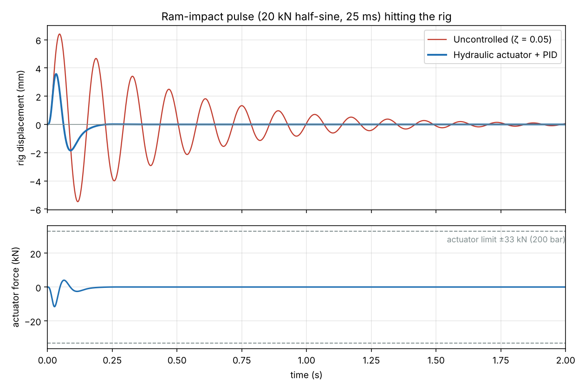
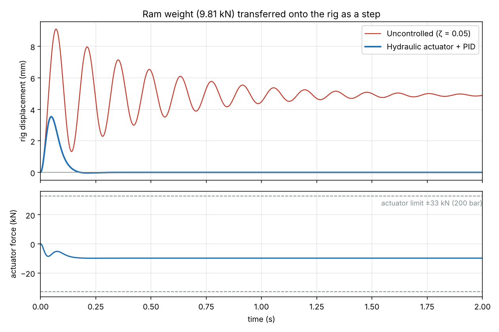
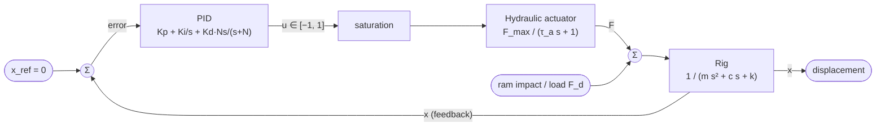
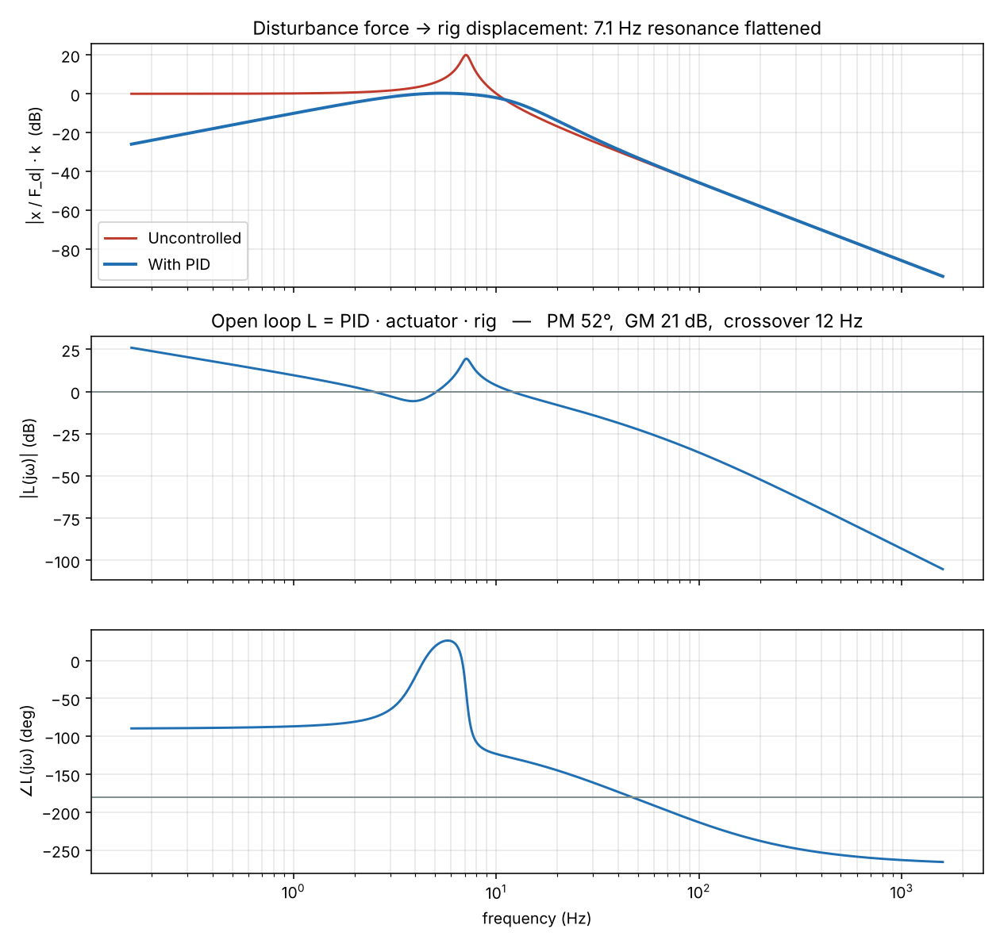
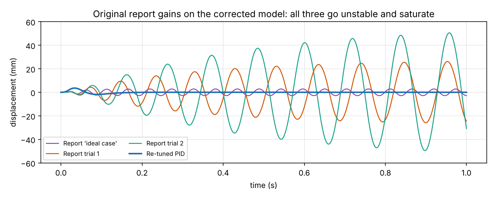

# Pile-Driver Rig: Active Vibration Damping with a Hydraulic Actuator + PID

**Control Engineering · Asia Pacific University · 2024 (individual section of a group assignment) · model rebuilt and re-tuned in 2026**

Impact pile drivers shake the rig and the ground around it every time the ram lands. This project models the rig as a lightly damped 7.1 Hz structure. A hydraulic cylinder pushes back against the vibration, driven by a PID controller on the rig's displacement.

The original coursework model had several derivation errors (listed [below](#what-was-corrected-from-the-original-coursework)). This repo is the corrected version: a physically derived actuator model, displacement feedback, and gains tuned against stability-margin and actuator-limit constraints. The results come from a script anyone can re-run.



## Results

| Test | Uncontrolled | With PID |
|---|---|---|
| Ram-impact pulse: peak displacement | 6.40 mm | **3.57 mm (−44%)** |
| Ram-impact pulse: time to settle below 0.1 mm | 1.88 s | **0.19 s (10× faster)** |
| Ram-impact pulse: RMS displacement over 2 s | 1.63 mm | **0.47 mm (−71%)** |
| Ram weight (9.81 kN) as a static load: permanent sag | 4.89 mm | **0 mm (integral action)** |
| Peak valve command / actuator force | — | 42% / 11.6 kN (limit 33 kN, so no saturation) |
| Stability margins | — | **PM 52°, GM 21 dB**, crossover 12 Hz |

The loop stays stable with ±20% rig mass (PM 48–54°). With twice the actuator lag (full-stroke chamber volume), the phase margin drops to 37°.



## Model



### Rig (single degree of freedom)

| | Value |
|---|---|
| Mass m | 1000 kg |
| Stiffness k | 2×10⁶ N/m |
| Natural frequency | ωₙ = √(k/m) = 44.72 rad/s, so **fₙ = ωₙ/2π = 7.12 Hz** |
| Damping | ζ = 0.05, so c = 2ζ√(km) = 4472 N·s/m |

### Hydraulic actuator: derived, not assumed

Cylinder: Ø50 mm bore, Ø20 mm rod, 200 mm stroke, 200 bar supply, 20 L/min pump, mineral oil β = 1.5 GPa.

- **Force limit.** The rod-side annulus area is A = π/4·(D² − d²) = 1.649×10⁻³ m². This is the weaker direction, so it sets the symmetric limit: F_max = P_max·A = **33.0 kN**, which is 3.4× the ram's weight.
- **Dynamics.** Chamber pressure follows dP/dt = (β/V)·(K_q·u − K_c·P). Pick the valve gains so that a full command (u = 1) settles at P_max: K_q = Q_max and K_c = Q_max/P_max. That gives a first-order lag:

  **F(s)/u(s) = F_max / (τ_a·s + 1)**, with **τ_a = V·P_max / (β·Q_max) = 6.6 ms**, where V = 165 cm³ (the mid-stroke chamber volume).

### Controller

The PID acts on rig displacement (setpoint 0) and outputs a normalised valve command u, which is clipped to ±1:

`u = −(Kp·x + Ki·∫x dt + Kd·ẋ_f)`, with **Kp = 20 /m, Ki = 1200 /(m·s), Kd = 1.8 s/m**. The derivative is filtered at N = 600 rad/s.

- **Derivative** does most of the work. It adds active damping, roughly 59 kN·s/m on top of the structure's own 4.5.
- **Integral** removes the static sag when the ram's weight comes onto the rig.
- **Proportional** is kept small. Extra stiffness costs phase margin against the actuator lag.

The gains come from a grid search ([`analysis/tune.py`](analysis/tune.py)). It looked for the shortest settling time across both tests while keeping phase margin ≥ 45°, gain margin ≥ 10 dB, and peak valve command ≤ 80%. The winner was then re-checked in a nonlinear simulation with actuator saturation.



## What was corrected from the original coursework

| | Original report / Simulink model | Corrected |
|---|---|---|
| Natural frequency | Formula written as ωₙ/π | fₙ = ωₙ/2π = 7.12 Hz (the value was right; the formula wasn't) |
| Damping | Derived c = 4472 N·s/m, but the model used 5000 | Consistent c = 4472 N·s/m (ζ = 0.05) |
| Piston area | π/4·(D² − d²) evaluated as 1.767×10⁻³ m² | 1.649×10⁻³ m² |
| Bulk modulus | 1.5×10⁵ in the table, 1.5×10⁹ in the working | 1.5×10⁹ Pa throughout |
| Actuator gain | Derived as A/m = 1.77×10⁻⁶; Simulink used 3.534×10⁻⁵ | Force actuator: F_max = 33 kN per unit command |
| Time constant | τ = β·V/Q, giving 1.59 s (the units are Pa·s, and with these numbers the value is actually ~1.6×10⁹) | τ_a = V·P_max/(β·Q_max) = 6.6 ms, from the chamber pressure equation |
| Feedback signal | Velocity differentiated again, so acceleration was fed back | Displacement x fed back |
| Comparison | Open-loop force step vs closed-loop setpoint step (not like-for-like) | The same disturbances (impact pulse, static load) applied to both |
| Gains | Kp up to 300,000, tuned by trial and error | Kp = 20, Ki = 1200, Kd = 1.8, chosen against explicit margin and effort limits |

On the corrected model, the original gain sets don't work. All three report gain sets fail the linear stability check and push the actuator to its limit:



The original Simulink file is kept in [`original/pid_original.slx`](original/pid_original.slx) for reference.

## Run it

```bash
pip install numpy scipy matplotlib control
python analysis/model.py           # prints every number in this README
python analysis/model.py --plots   # regenerates images/
cd analysis && python tune.py      # reruns the gain search
```

In MATLAB (Control System Toolbox), run [`matlab/pile_driver_pid.m`](matlab/pile_driver_pid.m). It builds the same model with `tf`, `pid` and `feedback`, prints the margins and plots both tests.

## Limitations and next steps

- The rig is a single mode. A real rig has more modes, and a two-mode model would show whether the controller excites the next one.
- The actuator is linearised at mid-stroke. Valve dynamics, deadband and the flow–pressure nonlinearity are left out. The 2×τ_a case shows how much phase margin a slower actuator costs.
- The impact force is an idealised half-sine. Measured accelerometer data from a rig would be the next step.
- Possible extensions: feedforward from the ram-drop timing (the impact time is known in advance), and a direct comparison with a passive tuned-mass damper.

## Tools

Python (NumPy, SciPy, python-control, Matplotlib) · MATLAB / Control System Toolbox · Simulink (original model)
